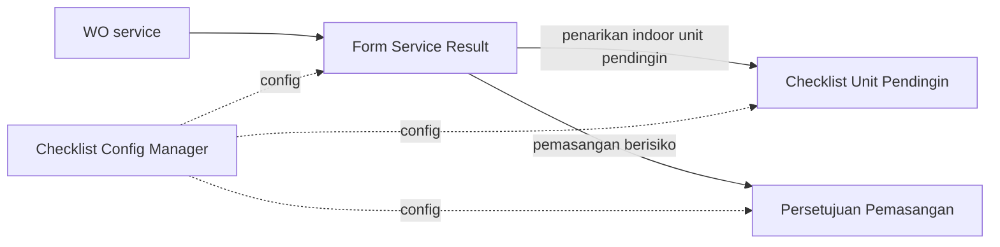

# Aplikasi

- [[Form Service Result]] `#app/fsr` — hub: Maintenance, Instalasi, Survey
- [[Checklist Unit Pendingin]] `#app/pendingin` — General Check dan Pengetesan Bocor Body
- [[Persetujuan Pemasangan]] `#app/persetujuan` — persetujuan konsumen untuk kondisi berisiko
- [[Checklist Config Manager]] `#app/manager` — editor config bersama + publish

Lihat juga [[Standar UI]].
